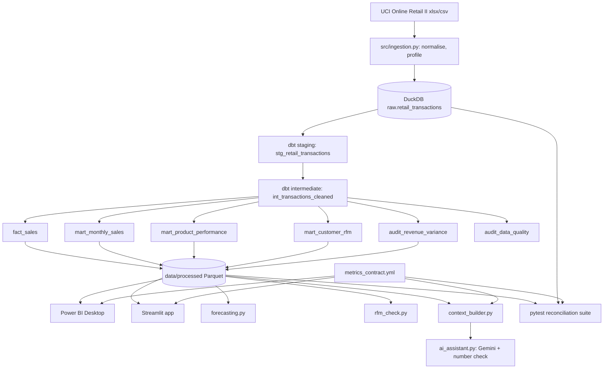
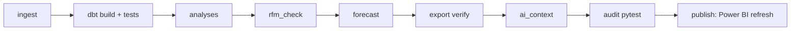

# Architecture

## Data flow (as built)

## Conceptual production orchestration (Airflow)

This is a documentation-only target-state diagram. Nothing in the project depends on Airflow;
locally the same order is run by `python run.py run_all`.

In Airflow each box would be a task; a failing dbt test or audit would stop the DAG before the BI refresh.
